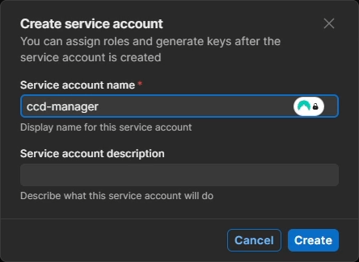
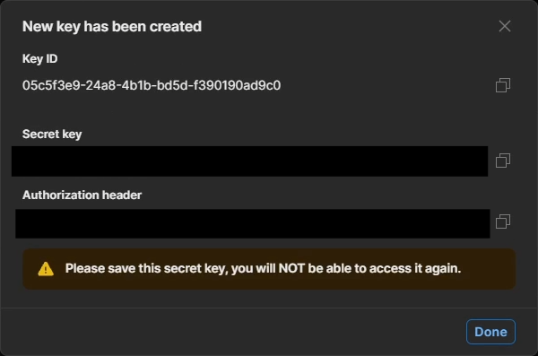
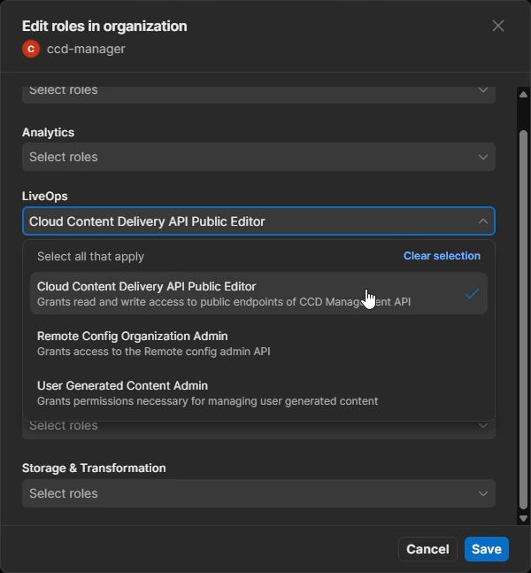
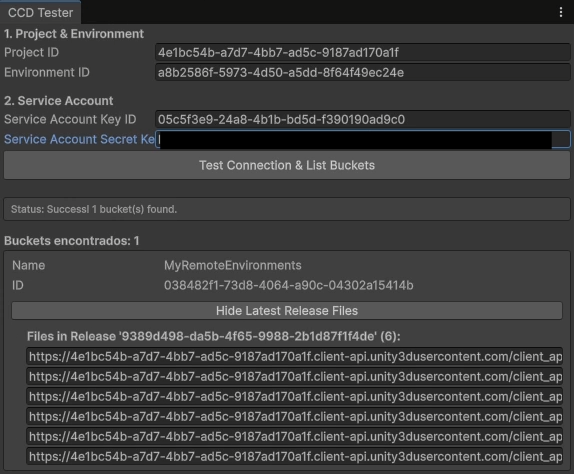
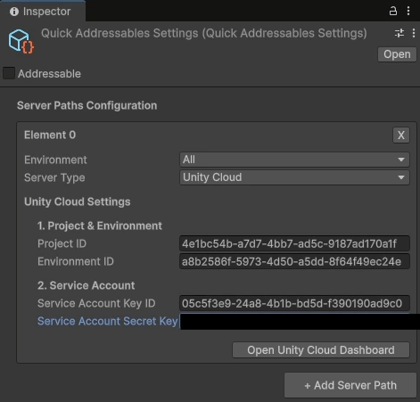
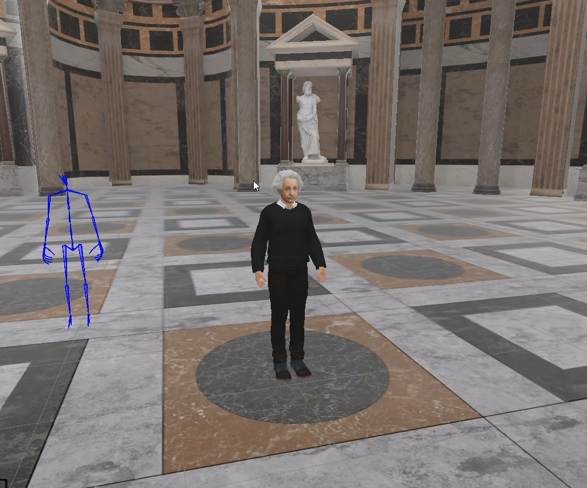

# Configuring the Main Project (Consumer)

The main VRUnited project acts as the consumer of the remote assets. It does not need the original prefabs or the CCD upload tools. Instead, it dynamically discovers and downloads content from Unity Cloud Content Delivery using a Service Account.

    <iframe src="https://www.youtube.com/embed/C5SI2WYTEqo" frameborder="0" allowfullscreen style="position: absolute; top: 0; left: 0; width: 100%; height: 100%;"></iframe>

## 1. Create a Service Account

To allow the main project to securely query the Unity Cloud API and discover your remote buckets, you must create a dedicated Service Account.

* Log into the [Unity Cloud Dashboard](https://cloud.unity.com/) and navigate to your organization (e.g., `EventLabProjects`).
* In the left-hand menu, navigate to **Administration > Service accounts**.[cite: 6]
* Click the **+ New** button in the top right corner.[cite: 6]
* Give the service account a descriptive name (e.g., `ccd-manager`) and click **Create**.[cite: 6]

*(Screenshot suggestion: Timestamp 00:34)*

## 2. Generate and Store Keys

Once the Service Account is created, you must generate the security keys required for authentication.

* In the Service Account details page, locate the **Keys** section and click **+ Add key**.[cite: 6]
* A dialog will appear displaying the new **Key ID** and the **Secret key**.[cite: 6]
* **Crucial Step:** You must copy and save the `Secret key` immediately (e.g., in a temporary Notepad file). For security reasons, Unity will never display this Secret key again once you close the dialog.[cite: 6]
* Click **Done**.[cite: 6]

*(Screenshot suggestion: Timestamp 00:54)*

## 3. Assign Permissions

For the Service Account to function, you must grant it specific roles to access your project's Cloud Content Delivery data.

* Scroll down on the Service Account page to the **Organization roles** section.
* Click **+ Manage organization roles**.[cite: 6]
* Under the **LiveOps** category, check the **Cloud Content Delivery API Public Editor** role and click **Save**.[cite: 6]

*(Screenshot suggestion: Timestamp 01:51)*

## 4. Check Remote Assets Access

With the credentials ready, you must configure the VRUnited main project to use them for discovering the remote environments.

* Open the main VRUnited Unity project.
* Navigate to **VRUnited > Test CCD Connection** from the top menu.[cite: 6]
* A custom window will appear. Input your **Project ID** and **Environment ID** (these can be found in the Cloud Dashboard under your project's CCD settings).[cite: 6]
* In the **Service Account** section, input the **Key ID** and the **Secret Key** you generated in Step 2.[cite: 6]
* Click the **Test Connection & List Buckets** button.[cite: 6]
* If successful, the window will list the buckets found in your cloud environment. Click **List Latest Release Files** to verify that your uploaded `.hash` and `.bundle` files are properly discovered.[cite: 6]

*(Screenshot suggestion: Timestamp 03:15)*

## 5. Configure the Server Path

Finally, you must permanently store these connection settings in the project so the dynamic loading system can use them at runtime.

* In the Project window, navigate to your Resources folder and locate the `QuickAddressablesSettings` object (or go to **VRUnited > Addressables Settings** if available).[cite: 6]
* In the Inspector, ensure the **Server Type** is set to **Unity Cloud**.[cite: 6]
* Input your **Project ID**, **Environment ID**, **Service Account Key ID**, and **Service Account Secret Key** into the corresponding fields.[cite: 6]

*(Screenshot suggestion: Timestamp 04:16)*

## 6. Checking Remote Assets in Play Mode

To verify the entire workflow, run the application in the Editor.

* Press the **Play** button in the Unity Editor.[cite: 6]
* Navigate through the VRUnited menu (e.g., select **Multiplayer**, then choose an avatar).
* When you reach the **Select Environment** screen, your remote scene (e.g., `My Pantheon`) should now appear alongside the local basic scenes.[cite: 6]
* Click on the remote scene to load it. The application will dynamically download the `.bundle` from the cloud and instantiate the environment.

*(Screenshot suggestion: Timestamp 05:32)*
