# Configuring Secondary Projects (Producers)

Secondary projects (also known as Producers) are standalone Unity projects where developers create, configure, and compile custom avatars or environments. Once compiled, these assets are uploaded to Unity Cloud Content Delivery (CCD) so the main VRUnited application can download them dynamically.

<div style="position: relative; padding-bottom: 56.25%; height: 0; overflow: hidden; max-width: 100%; height: auto; margin-bottom: 2rem;">
    <iframe src="https://www.youtube.com/embed/2kW52V9r6nc" frameborder="0" allowfullscreen style="position: absolute; top: 0; left: 0; width: 100%; height: 100%;"></iframe>
</div>

## 1. Creating the CCD Bucket

To prevent assets from different secondary projects from overwriting each other, you must create an independent Bucket for each producer project.

* Log into the [Unity Cloud Dashboard](https://cloud.unity.com/) and select your main VRUnited project.
* Navigate to **LiveOps > Cloud Content Delivery**.
* In the top-right corner, click **Create Bucket**.
* Name the bucket after the specific content you are producing (e.g., `MyRemoteEnvironments`) and complete the creation process.

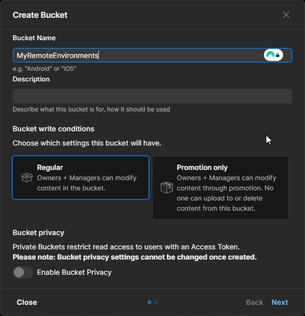

## 2. Bucket Initialization

Before configuring Unity, you must initialize the newly created bucket. This step is mandatory. Since the bucket was just created, it does not have any active Releases. Without at least one Release, the Cloud Dashboard will not generate the internal metadata (Project ID, Environment ID, Bucket ID) that you will need later to configure your Addressables.

To force the creation of the first Release and reveal these IDs, you must upload a dummy file:

* In the Dashboard, open the bucket that you created in the previous step. 
* Click the **Upload content using the dashboard** option (or click "Upload Files").
* Drag and drop any small, temporary file from your computer (e.g., a simple text file named `MyDummyFile.txt`) into the drop area.
* Once the upload finishes, a "Create Release" dialog will appear. Click **Submit** to confirm.
* Wait a few seconds for the Dashboard to refresh. You should now see the `Release 1` badge and, more importantly, a new section detailing your **Project ID**, **Environment ID**, and **Bucket ID**.

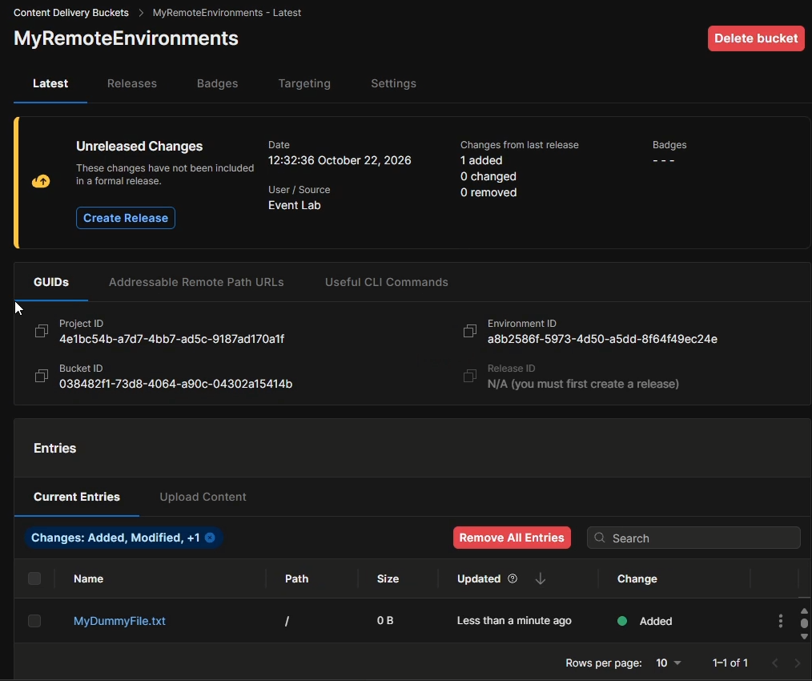

Now that you have access to the necessary IDs, you must clean up the bucket to ensure it remains strictly for your project assets:

* In the dashboard, click **Remove All Entries**.
* Click **Create Release** again and confirm to generate a new empty Release (e.g., `Release 2`). Your bucket is now empty and properly initialized with all its IDs exposed.

## 3. Installing the VRUnited SDK

With the cloud bucket initialized, the next step is to configure your local Unity editor to handle remote asset creation. To do this, you must install the VRUnited SDK, which contains the automatic CCD configuration tools.

* Open your secondary Unity project, i.e., the Addressables producer.
* Navigate to **Window > Package Manager**.
* Click the `+` icon in the top-left corner and select **Add package from git URL...**
* Input the VRUnited SDK repository URL:

```text
https://github.com/vrunited/vrunited.sdk.git
```

* Click **Install** to proceed with the package installation. Wait for the process to finish. 

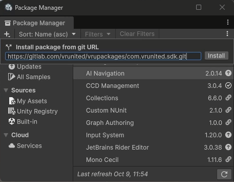

## 4. Configuring the Addressables Profile

To ensure files are organized by platform (Windows vs Android) without overwriting each other, use the custom CCD configuration tool included in the VRUnited SDK.

* From the top menu, go to **VRUnited > Init Addressable Settings**. This action automatically creates the `VRUnited` profile and initializes the required labels (`VRUSceneSettings` and `VRUAvatar`).
* Go to **Window > Asset Management > Addressables > Profiles** and ensure the newly created `VRUnited` profile is set as the active profile.
* In the profile settings, select **Custom** from the dropdown menu for both `Local` and `Remote` paths.

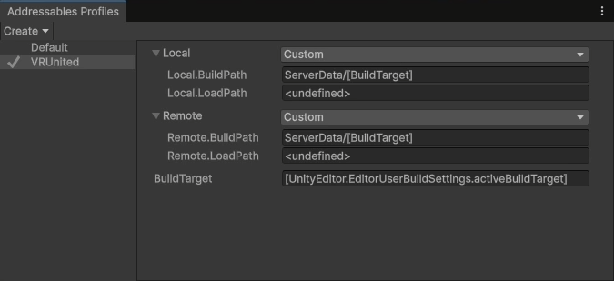

* From the top menu, go to **VRUnited > CCD Configuration**.
* A custom window will appear. Input the **Project ID**, **Environment ID**, and **Bucket ID** matching the bucket you initialized in Step 2.

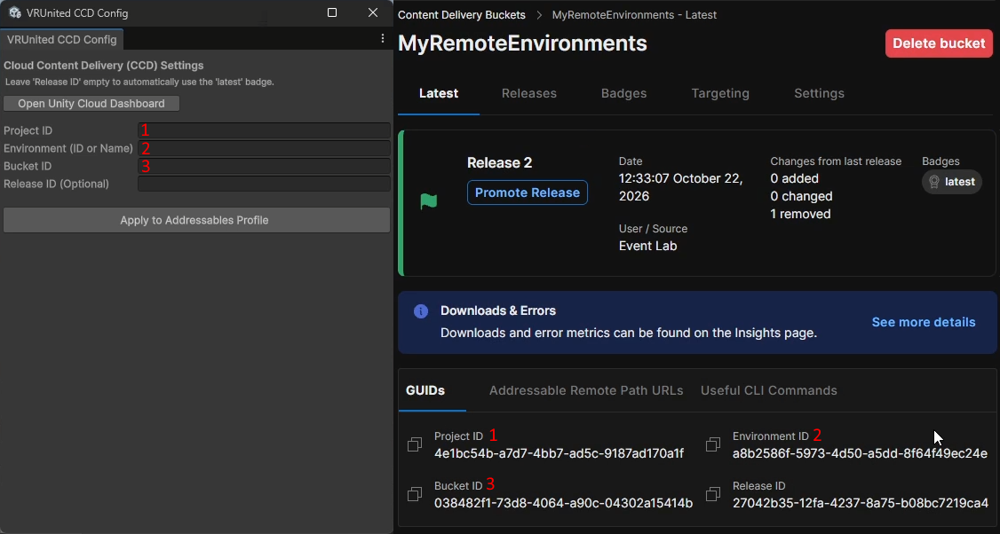

* Leave the **Release ID** field empty to automatically target the `latest` version.
* Click **Apply to Addressables Profile**. This will modify the **Remote.LoadPath** to automatically point to your bucket, and `[BuildTarget]` macro is used ensuring builds are strictly separated into `StandaloneWindows64/` and `Android/` paths during compilation.
* Once the CCD Settings are applied, go to **Window > Asset Management > Addressables > Settings**.
* In the Inspector, locate the **Catalog** section.
* Ensure the **Build Remote Catalog** checkbox is enabled. 
* Verify that both **Build & Load Paths** dropdowns just below it are set to **Remote**.

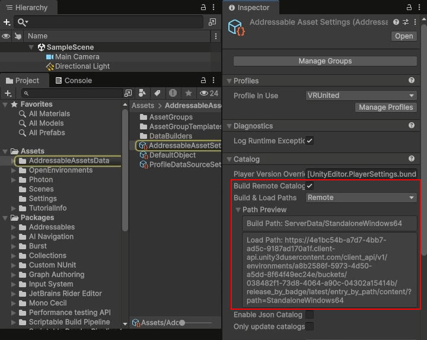

## 5. Create Addressables Group

Before marking specific assets as Addressables, you must create a dedicated Group configured to handle remote compilation and distribution. 

* Navigate to **Window > Asset Management > Addressables > Groups**.
* Ensure that you have the **VRUnited Profile** selected. 
* In the Addressables Groups window, click on **Create > Group > Packed Assets** to generate a new empty group.
* Rename the newly created group to something descriptive (e.g., `MyRemoteAssets`).
* Select your new group (`MyRemoteAssets`).
* In the Inspector window, under the **Content Packing & Loading** section, ensure **Build & Load Paths** is set to **Remote**. 
* Leave the **Advanced Options** section with the default values. 

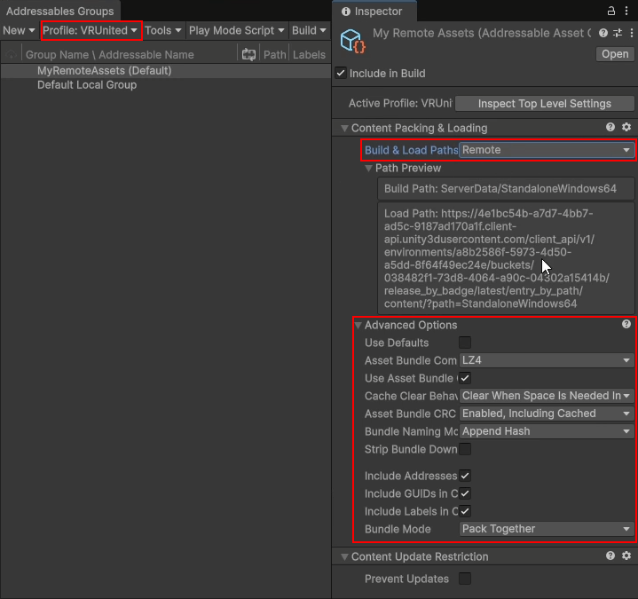

## 6. Configure Remote Scene

Once your Addressables group is ready, you must prepare the actual Unity Scene that will be distributed remotely. This process is exactly the same as configuring a local scene, requiring the setup of valid spawn points for the avatars.

* Open the scene that you want to distribute (e.g., `RomanPantheon`).
* In the Hierarchy, create an Empty GameObject (e.g., `__SpawnPoints__`) to organize your spawn locations.
* Create another Empty GameObject as a child of the previous one (e.g., `SpawnPoint_00`).
* Select `SpawnPoint_00`, click **Add Component** in the Inspector, and search for the **VRU Spawner Point** script to attach it.

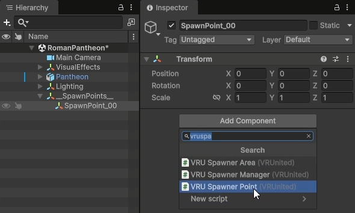

* Use the Move Tool to position the `Spawn_00` object exactly where you want the player to appear within the room.
* Configure the **VRU Spawnner Point** attributes in the Inspector:
    * **Initial Pose:** Defines the starting pose of the avatar (e.g., whether they will appear sitting or standing).
    * **Reserved For:** A list containing the IDs (Addresses) of the avatars for which this spawn point is reserved. If the list is empty, any avatar can use this spawn point. If it contains one or more elements, only avatars with those matching Addresses can spawn here.

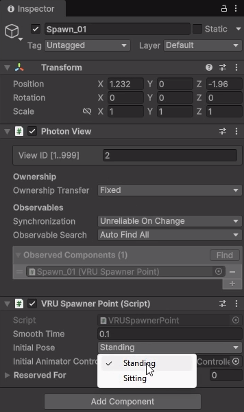

* Repeat this process (creating additional child objects like `Spawn_01`, `Spawn_02`, etc.) to define all the spawn points needed for the maximum number of players the scene supports.

## 7. Create Scene Addressables

With your remote scene properly configured with spawn points, you must now create a settings descriptor for it, mark both as Addressables, and assign them to your remote group.

* First, locate your configured scene (e.g., `RomanPantheon`) in the Project window.
* Right-click anywhere in the project folder and navigate to **Create > VRUnited > Scene Settings** to generate a new settings object.
* Rename this new object descriptively (e.g., `RomanPantheonSceneSettings`).
* Select the newly created `VRUSceneSettings` object and configure its properties in the Inspector:
    * **Scene:** Drag and drop your actual remote scene (`RomanPantheon.unity`) into this field.
    * **Address:** This is the internal ID. It **must strictly match** the exact filename of your scene (in this case, type `RomanPantheon`).
    * **Display Name:** The friendly name that will appear in VRUnited's UI environment selector (e.g., `My Pantheon`). This does not need to match the filename.
    * **Thumbnail:** (Optional but recommended) A representative image of the scene that will be displayed in the VRUnited menu.

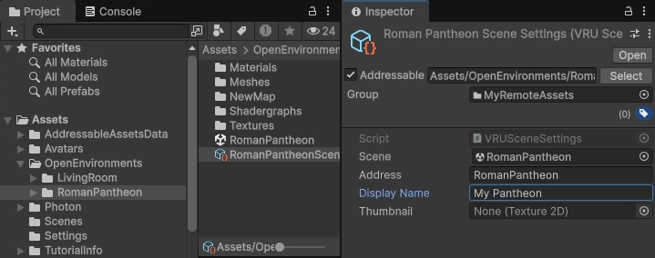

* Now, select both the scene file (`RomanPantheon`) and the settings object (`RomanPantheonSceneSettings`) in the Project window and drop both assets into your newly created remote group (e.g., `MyRemoteAssets`).
* **Crucial Step:** In the Addressables Group window, ensure the **Address** string for the settings object is simplified to match its own filename exactly (`RomanPantheonSceneSettings`), and the **Address** for the scene matches its filename (`RomanPantheon`).
* Finally, with the settings object selected in the Addressables window, click the dropdown in the **Labels** column and apply the **VRUSceneSettings** label. This allows the main project to discover it as a valid environment.

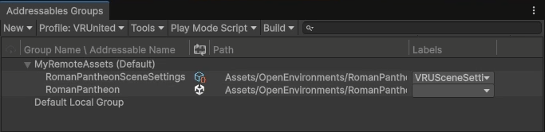

## 8. Create Avatar Addressables

The process for remotely distributing avatars is much simpler, as it does not require a custom settings descriptor.

* In the Project window, locate the avatar prefab you wish to distribute remotely.
* Drag and drop your avatar prefab into your remote group (e.g., `MyRemoteAssets`).
* **Crucial Step:** In the **Address** field, you must set the name to match the unique alphanumeric ID that users will use to unlock or load this avatar in the VRUnited avatar selector. It does not need to match the filename.
* With the avatar selected in the Addressables Groups window, click the dropdown in the **Labels** column and apply the **VRUAvatar** label. This critical step ensures the main project identifies the asset as a playable character.

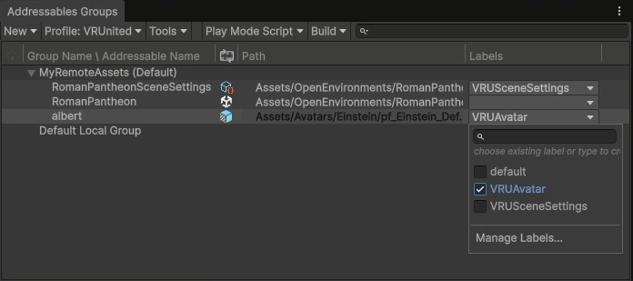

## 9. Build Addressables

Before pushing your assets to the cloud, you must compile them locally. This process generates the `.bundle` files, remote catalogs, and hashes required by the Addressables system.

* Open the Addressables Groups window (**Window > Asset Management > Addressables > Groups**).
* If you have built assets previously, it is highly recommended to first click **Build > Clean Build > All** to clear out old data and prevent conflicts.
* Click on **Build > New Build > Default Build Script** to start the compilation.
* Wait for the process to finish. Unity will automatically generate the files and store them in your local `ServerData/[BuildTarget]` directory (e.g., `ServerData/StandaloneWindows64`).
* **Crucial Step:** You must repeat this build process for **every platform** you want to support. Go to **File > Build Profiles** (or **Build Settings**), select your next target platform (e.g., *Android*), click **Switch Platform**, and then run the **Build > New Build > Default Build Script** command again.

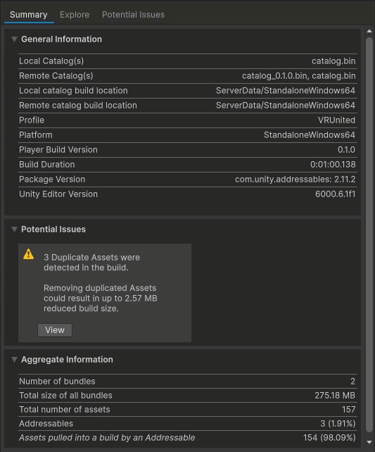

## 10. Uploading to CCD

Once your assets are built locally, the final step is to upload them to your Unity Cloud bucket using the web dashboard.

* Open your web browser and navigate to the [Unity Cloud Dashboard](https://cloud.unity.com/).
* On the left menu, select **Cloud Content Delivery** and open your specific bucket (e.g., `MyRemoteEnvironments`).
* Click the **Upload Content** option.
* Open your local file explorer and navigate to your Unity project's `ServerData` directory. 
* **Crucial Step:** Select the entire platform folder you just built (e.g., the `StandaloneWindows64` folder itself, not the files inside it) and drag and drop it into the Unity Cloud Dashboard drop area. This ensures the logical path is maintained so Android and Windows files do not overwrite each other.

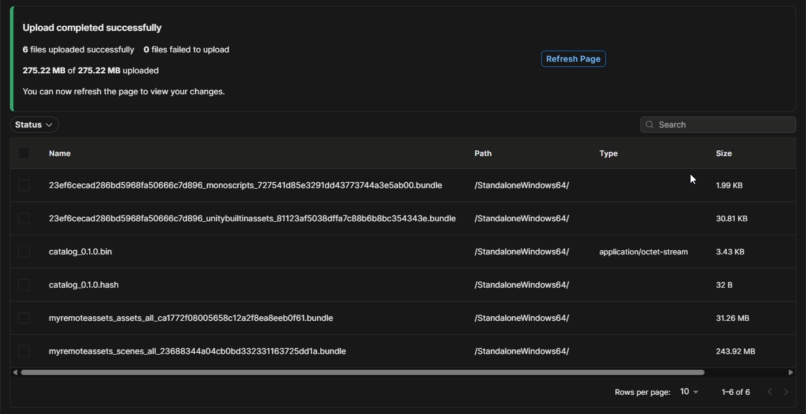

* Once the upload finishes, you must click the blue **Create Release** button. This step is mandatory to package your uploaded files into an official version and automatically update the `latest` badge so VRUnited can detect them.
* A confirmation dialog will appear. Click **Next** or **Submit** to finalize the release.
* **Repeat:** You must repeat this build, upload, and release process for every other platform you need (e.g., build for `Android`, then drag and drop the `Android` folder into the dashboard).

