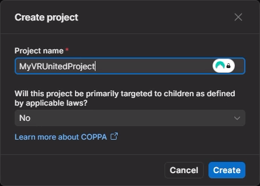
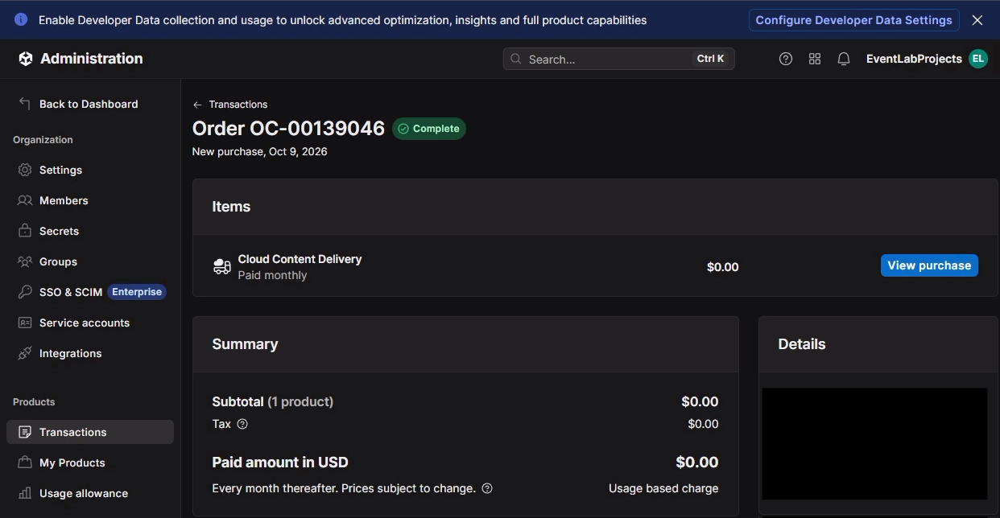

# Setting Up Unity Cloud Content Delivery

Before configuring any Unity project, the cloud infrastructure must be properly set up in the Unity Dashboard. VRUnited uses Unity Cloud Content Delivery (CCD) to host and distribute Addressables globally without the need for a dedicated web server.

    <iframe src="https://www.youtube.com/embed/TU_YOUTUBE_ID" frameborder="0" allowfullscreen style="position: absolute; top: 0; left: 0; width: 100%; height: 100%;"></iframe>

## Creating the Project and Enabling CCD

Unity Cloud Content Delivery features a generous free tier ideal for development and moderate traffic. Cloud Storage and Content Management are completely free, and you get **50 GB of free bandwidth per month**. 

To activate the service, Unity requires a valid credit or debit card. This is a standard procedure to verify identity and enable usage-based services. A small temporary hold may be placed on your card, but it will be released automatically. The initial checkout amount is **$0.00**.

Follow these steps to create your project and activate the service:

* Log into the [Unity Cloud Dashboard](https://cloud.unity.com/).
* In the Projects section, click on **+ New**.
* Enter your project name (e.g., `MyVRUnitedProject`) and click **Create**.

* Once inside your new project's dashboard, navigate to the left sidebar and select **Cloud Content Delivery**.
* Click the **Launch** button to start the setup process.
* On the product details page, click **Continue to purchase**.
* Accept the Terms and Conditions, then click **Continue to checkout**.
* Enter your billing details and complete the checkout process to fully enable the CCD environment.

With the project created and CCD activated, you are now ready to configure your secondary projects (Producers) to start uploading content to the cloud.

---

## FAQ & Account Management

**What happens if my application exceeds the 50 GB free tier in a month?**

Unity does not currently offer an automatic "hard cap" feature to block downloads once the limit is reached. If your users download more than 50 GB, the service will not be interrupted, and Unity will automatically charge your card for the excess data at the end of the month (currently around $0.08 per additional GB). 
*Tip: To avoid unexpected charges, it is highly recommended to set up **Budget Alerts** in the Unity Dashboard (Administration > Billing). You can configure it to send you an email alert as soon as your monthly cost exceeds $0, allowing you to manually disable the content if you do not wish to pay for extra bandwidth.*

**How can I change the credit card associated with the project (e.g., from a personal to a corporate card)?**

You cannot change the card directly from the CCD tab. You must update it at the organization level:
1. Ensure your organization is selected in the top-right corner.
2. Go to **Manage organization > Administration > Billing & cost > Payment methods**.
3. Click **Add payment method** and enter the new card details.
4. Click the three dots (`...`) next to the new card and select **Set as default**.
5. Once the new card is the default, you can delete your old personal card.

**How do I completely cancel the CCD service to avoid any future charges?**

Since CCD uses usage-based billing, there is no traditional "Cancel Subscription" button. To guarantee a $0 bill, you must reduce your usage and storage to zero:
1. **Delete all Buckets:** Go to your project's CCD settings, enter each bucket, and click **Delete Bucket**. This stops all downloads and clears your storage.
2. **Revoke Access:** Go to **Administration > Service Accounts** and delete the accounts used for CCD (e.g., `ccd-manager`) to prevent any further API connections.
3. **Remove Payment Method:** (Optional) If your organization does not use other paid Unity services, go to **Billing & cost > Payment methods** and remove the card.

## Official Documentation

For more in-depth information, you can refer to the official Unity guides:
* [Unity Cloud Content Delivery (CCD) Documentation](https://docs.unity.com/ccd/en/manual)
* [Unity Cloud Billing & Organizations](https://docs.unity.com/cloud/en-us/manual/organizations/billing-and-subscriptions)